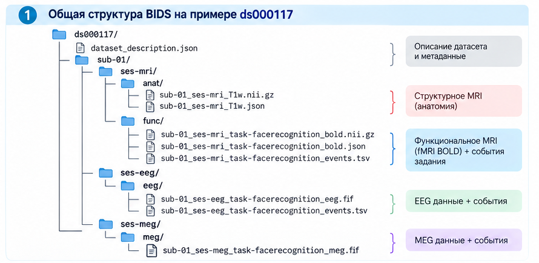
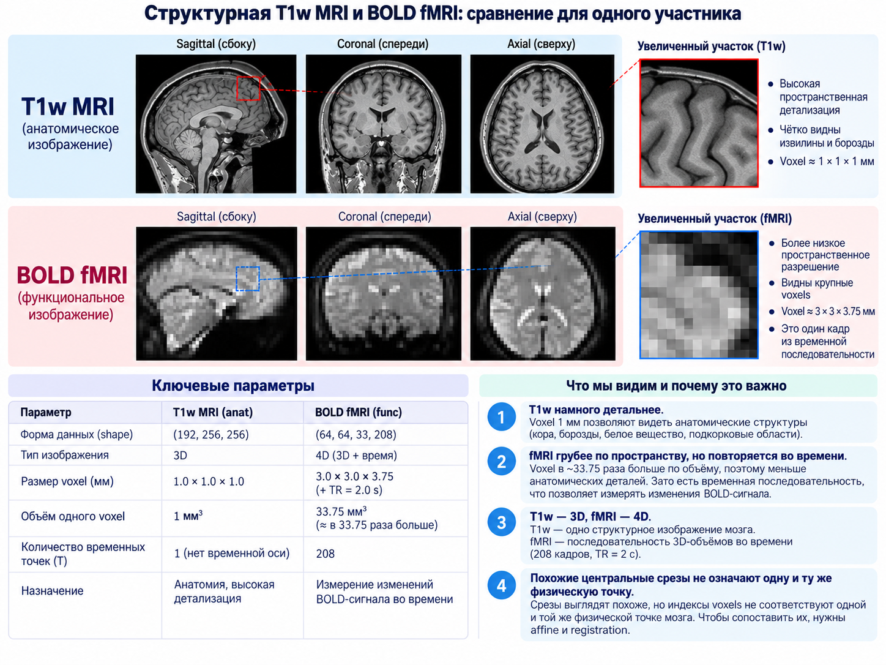

# neuro_ai

A learning-to-research project in neuroimaging, computational cognitive science, computational neuroscience, and NeuroAI.

The project begins with real multimodal neuroimaging data from the University of Cambridge / MRC Cognition and Brain Sciences Unit and gradually moves from understanding experiments and BIDS data to fMRI analysis, EEG/MEG, machine learning, multimodal analysis, and NeuroAI.

## Current stage

**Stage 1: Neuroimaging foundations**

Main dataset: **Wakeman & Henson multimodal neuroimaging dataset, OpenNeuro ds000117**.

The first practical neuroimaging checkpoint is now substantially complete. Using real `sub-01` data, the project has:

- loaded a BOLD NIfTI file with NiBabel;
- inspected the real 4D shape `(64, 64, 33, 208)`;
- inspected voxel size and TR `(3.0, 3.0, 3.75, 2.0)`;
- extracted and visualized sagittal, coronal, and axial slices from a real fMRI volume;
- loaded the participant's structural T1w MRI `(192, 256, 256)` with `1 mm` isotropic voxels;
- compared structural MRI and BOLD fMRI spatial resolution;
- inspected the real affine matrices for both images.

Current topic: **voxel coordinates → affine → world coordinates → spatial correspondence between fMRI and T1w**.

After the spatial/data foundations are secure, the next analysis sequence will be:

`events → HRF → design matrix → GLM`.

## Visual overview

### How the real dataset is organized

The project starts from the structure of a real BIDS dataset: participant/session hierarchy, structural MRI, BOLD fMRI, acquisition metadata, and experimental events.

### Structural T1w MRI vs BOLD fMRI

The same participant is represented by different image types and voxel grids. T1w MRI provides high-detail anatomy, while BOLD fMRI provides repeated measurements over time at lower spatial resolution.

## Current learning materials

- [01 - NIfTI, fMRI and structural MRI: first practical checkpoint](docs/01_nifti_mri_fmri_basics.md)
- [01 - Real-data NIfTI / fMRI / T1w notebook](notebooks/01_nifti_mri_fmri_basics.ipynb)
- [Learning protocol](docs/LEARNING_PROTOCOL.md)

## Learning principle

Experiment → data → statistics → fMRI → ML → EEG/MEG → multimodal analysis → NeuroAI.

Complex methods are introduced only after the underlying data and assumptions are understood.

## Repository structure

- `notebooks/` — learning and research notebooks
- `src/` — reusable Python code
- `tests/` — tests for reusable code
- `configs/` — project configuration files
- `docs/` — learning chapters, project documentation, and methodological notes
- `figures/` — conceptual learning figures and data visualizations
- `results/` — derived numerical results
- `reports/` — research reports and drafts
- `references/` — notes and references to papers and datasets
- `data/` — local neuroimaging data; raw data are not committed to Git

## Language

The project is bilingual. Code, file names, variables, and technical identifiers are written in English. Explanatory materials may be available in Russian and English.

Russian version: [README_RU.md](README_RU.md)
