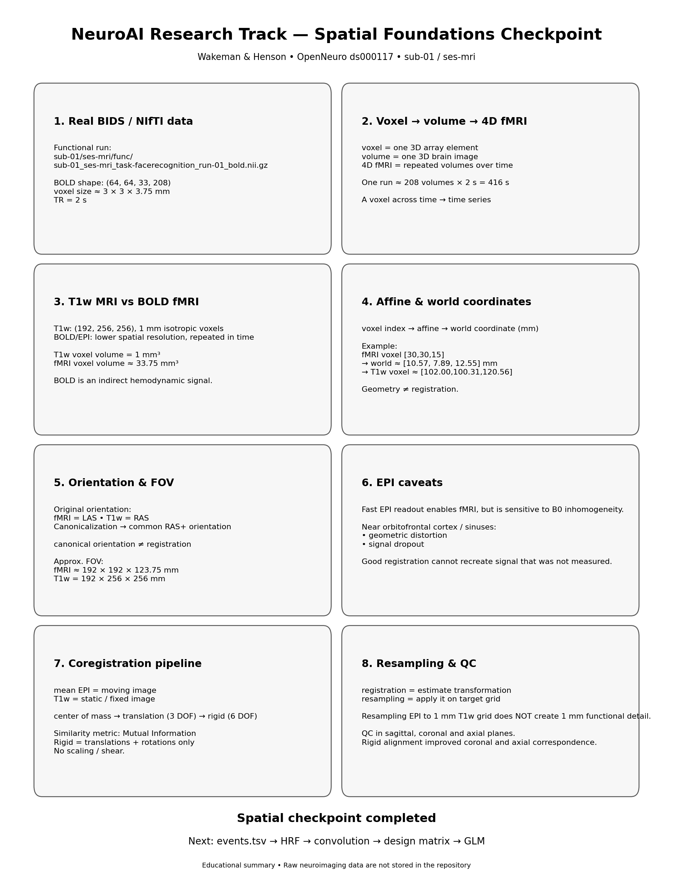
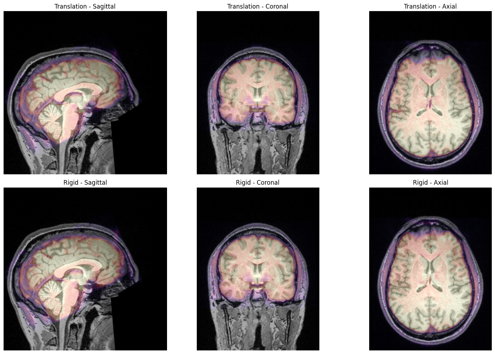
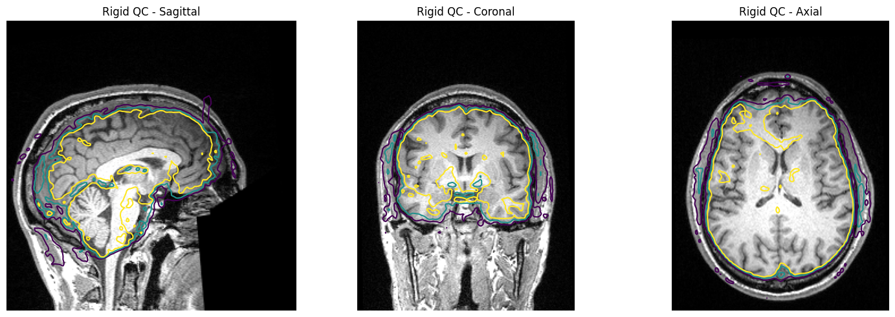

# neuro_ai

Учебно-исследовательский проект по нейровизуализации, computational cognitive science, computational neuroscience и NeuroAI.

Проект использует реальные мультимодальные нейровизуализационные данные **Wakeman & Henson (OpenNeuro ds000117)** и последовательно движется от структуры эксперимента и данных к fMRI-анализу, EEG/MEG, машинному обучению, мультимодальному анализу и NeuroAI.

## Текущий этап

**Этап 1: основы нейровизуализации — пространственный блок закрыт**

На реальных MRI/fMRI данных `sub-01` мы прошли:

- BIDS и реальные NIfTI-файлы;
- voxel, volume, 4D fMRI и TR;
- structural T1w MRI vs BOLD fMRI / EPI;
- affine и преобразование `voxel ↔ world coordinates`;
- orientation (`LAS`, `RAS`) и canonical orientation;
- field of view (FOV) и различия покрытия;
- EPI distortion и signal dropout как отдельные ограничения;
- построение mean EPI;
- mutual information как metric для multimodal registration;
- center-of-mass initialization;
- translation-only registration (3 DOF);
- rigid coregistration EPI→T1w (6 DOF);
- resampling на T1w voxel grid;
- visual QC в sagittal, coronal и axial плоскостях.

Пространственный pipeline в notebook учебный: он нужен для понимания механизмов. Для будущего статистического анализа будет использоваться стандартный preprocessing workflow.

**Следующий блок:**

`events.tsv → временная структура эксперимента → HRF → convolution → design matrix → GLM`

## Визуальный обзор

### Структура реального датасета

### Structural T1w MRI vs BOLD fMRI

### Итог пространственного блока

### Quality control coregistration

## Текущие учебные материалы

- [01 — Пространственные основы MRI/fMRI: NIfTI, orientation и coregistration](docs/01_nifti_mri_fmri_basics.md)
- [01 — Notebook с реальными NIfTI / MRI / fMRI данными](notebooks/01_nifti_mri_fmri_basics.ipynb)
- [Протокол обучения](docs/LEARNING_PROTOCOL.md)

## Принцип обучения

Эксперимент → данные → статистика → fMRI → ML → EEG/MEG → мультимодальный анализ → NeuroAI.

Сложные методы добавляются только после понимания данных, предпосылок и ограничений измерения.

## Структура репозитория

- `notebooks/` — учебные и исследовательские notebooks
- `src/` — переиспользуемый Python-код
- `tests/` — тесты
- `configs/` — конфигурационные файлы
- `docs/` — учебные главы и методические заметки
- `figures/learning/` — концептуальные учебные изображения
- `figures/results/` — результаты и QC-визуализации на реальных данных
- `results/` — производные численные результаты
- `reports/` — исследовательские отчёты и черновики
- `references/` — заметки по статьям и датасетам
- `data/` — локальные нейроданные; raw data в Git не загружаются

## Язык проекта

Проект двуязычный. Код, имена файлов, переменных и технические идентификаторы пишутся на английском. Объяснительные материалы могут быть на русском и английском.

English version: [README.md](README.md)
