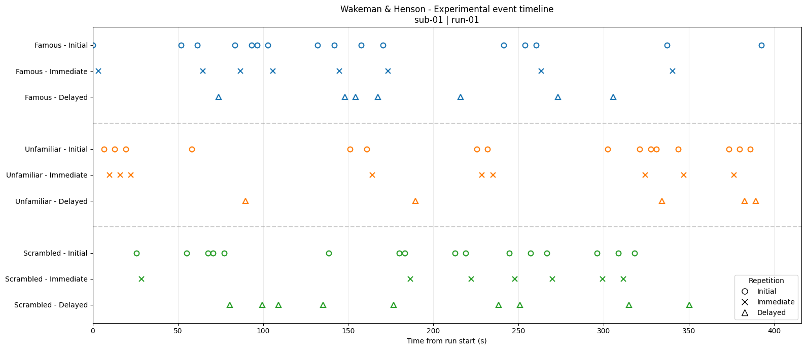
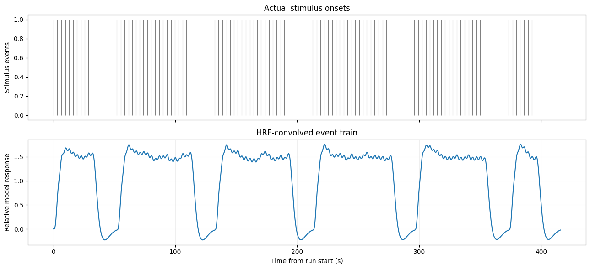
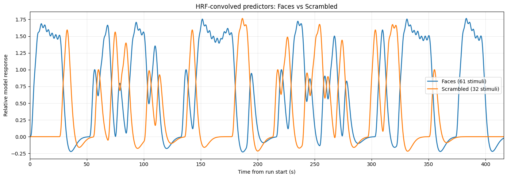

# Experimental events → HRF → convolution

**NeuroAI Research Track · Wakeman & Henson · OpenNeuro `ds000117`**  
**Learning note (2026-10-18) · `sub-01` / `ses-mri` / `task-facerecognition` / `run-01`**

## 1. Что изучили и зачем

Для анализа fMRI необходимо связать **расписание экспериментальных событий** с временным рядом BOLD. Сканер записывает BOLD (косвенный, гемодинамический показатель), а `events.tsv` сообщает **когда и какой стимул предъявляли**. События не обязаны приходиться на границы fMRI-томов.

В этом run: **208 volumes × TR 2 s = 416 s**. В таблице событий **93 предъявления стимулов** и **92 нажатия кнопок**, которые нельзя смешивать с предъявлениями.

## 2. Эксперимент и кодирование событий

Три категории стимулов: **famous faces (FF)**, **unfamiliar faces (UF)**, **scrambled (SF)**. Три режима предъявления: **initial (Ini)**, **immediate (Imm)** и **delayed (Del)**. Всего **3 × 3 = 9 условий**. `trial_type` хранит их комбинации: `IniFF`, `ImmUF`, `DelSF` и т. д.

| Показатель | Значение | Как интерпретировать |
|---|---:|---|
| `onset` | секунды от начала run | **Абсолютное время** события в рамках run |
| `duration` | секунды | Длительность предъявления, пока в импульсной модели не учтена |
| `trial_type` | код условия | Тип стимула и повторения; `btnL`/`btnR` — отдельные ответы |
| `response_time` | секунды | Время реакции в соответствующей строке, **не новый onset стимула** |

Для первого будущего контраста объединяем FF + UF в **faces (61)** и сравниваем со **scrambled (32)**. Это аналитическая группировка, а не утверждение о реакции мозга.

## 3. HRF: ожидаемая задержанная форма ответа

**Hemodynamic response function (HRF)** описывает, как краткое экспериментальное событие может быть связано с медленным BOLD-изменением в модели. Canonical HRF обычно достигает положительного пика примерно через 4–6 секунд и может иметь более позднюю отрицательную фазу (*undershoot*). Форма зависит от региона, человека и условий; canonical HRF — допущение модели, а не измеренная HRF этого участника.

Два события в `events.tsv`: `IniUF` при **6.647 s**, `ImmUF` при **9.838 s**. При одинаковой форме HRF ожидаемые ответы: `h(t - 6.647)` и `h(t - 9.838)`. Их суммарный пик может быть выше каждого отдельного, но не обязан совпадать с моментом максимума любого из них. Изменение условного веса второго события с **1.0** до **0.5** меняет как высоту, так и положение суммарного пика. **Это иллюстрация, а не доказательство repetition suppression.**

## 4. Свёртка: от onsets к модельному BOLD-предиктору

Для дискретной временной сетки:

$
x[n] = (s*h)[n] = \sum_k s[k] h[n-k]
$

- `s[k]`: события в момент `k` и их **заданные модельные веса**;
- `h[n-k]`: ответ на событие спустя `n-k` шагов;
- `x[n]`: **ожидаемая сумма модельных ответов**, не измеренный BOLD.

Ручной контроль: `s=[0,1,0,1,0,0,0,0]`, `h=[0,1,2,2,1]`. Тогда `x=[0,0,1,2,3,3,2,1]`, в частности `x[4]=h[3]+h[1]=2+1=3`. `np.convolve(s,h,mode='full')[:len(s)]` воспроизводит результат.

В реальных данных для удобства использовали сетку **0.1 s**, приводили onsets к ближайшему bin и сворачивали с нормированной canonical SPM HRF. **Шаг модели 0.1 s не заменяет реальный TR 2 s.** Весь run даёт 4160 модельных временных точек, но только 208 реально приобретённых fMRI volumes.

## 5. Почему 93 события превращаются в плато с «гребёнкой»

HRF длится дольше межстимульных интервалов, поэтому ответы **перекрываются**. Частые предъявления формируют широкие плато; мелкие колебания отражают известную временную структуру событий и форму выбранной HRF. Отрицательные участки происходят из модельного undershoot. Из этих модельных кривых нельзя заключить, насколько сильно на самом деле активировался мозг.

## 6. Два предиктора: faces / scrambled

Строим два отдельных event train и два конволюционных предиктора, **используя одну и ту же HRF и единичные веса событий**:

$
x_{faces} = s_{faces}*h, \qquad x_{scrambled}=s_{scrambled}*h.
$

Проверка линейности:

$
(s_{faces}+s_{scrambled})*h = x_{faces}+x_{scrambled}=x_{all}.
$

В ноутбуке `np.allclose(face_predictor + scrambled_predictor, predictor)` вернул **`True`**. Кривые могут выглядеть по-разному из-за **расписания** событий; более высокий пик `faces` ещё не означает больший измеренный BOLD-ответ на лица.

## 7. Ограничения и исследовательская интерпретация

- Здесь строятся **ожидаемые предикторы**, а не анализируются экспериментальные BOLD time series.
- События пока моделируются **импульсами**: реальные `duration` ещё не учтены.
- Используются одна canonical HRF и **допущение линейной суперпозиции**; реальные ответы могут отклоняться.
- Onsets округлены к шагу 0.1 s (максимальная ошибка округления около 0.05 s).
- Возможное временное перекрытие предикторов усложняет раздельную оценку их вкладов; это обсудим при построении design matrix.
- Отсутствуют оценённые `β`, GLM, статистический контраст `faces > scrambled` и выводы об индивидуальной активности, нейронном механизме или repetition suppression.

## 8. Словарь

| Термин | Краткое значение |
|---|---|
| `event train` | Временной ряд с заданными импульсами в моменты событий |
| `onset` | Время начала события относительно старта run |
| `canonical HRF` | Стандартная предполагаемая форма гемодинамического ответа |
| `convolution` | Сумма копий HRF, сдвинутых ко всем событиям и взвешенных по амплитуде |
| `predictor` / `regressor` | Модельная переменная, которой позже объясняют вариацию измеренного BOLD |
| `design matrix` | Матрица регрессоров для GLM; **ещё не построена** |

## 9. Контрольные вопросы

1. Почему один выраженный максимум конволюционного предиктора не равнозначен одному стимулу?
2. Почему сумма двух ответов с пиками по 1 может иметь максимум 1.57, а не 2?
3. Почему `h[3]` — это **значение элемента** массива HRF, а не число 3?
4. Почему более высокий модельный предиктор faces не доказывает больший измеренный BOLD-ответ?
5. Зачем нужен отдельный временной предиктор scrambled, если сумма обоих равна общему?

## Project progress / Next step

**Освоено:** `events.tsv` → 9 условий → HRF → ручной пример → `np.convolve()` → общий предиктор из 93 событий → `faces` и `scrambled` → проверка линейности. Пространственный checkpoint был закрыт ранее.

**Следующий шаг:** `event durations → sampling at 208 fMRI acquisition times → design matrix`, затем GLM на **предобработанном** BOLD. До этого статистические выводы не делаем.

**Notebook:** [`notebooks/01_nifti_mri_fmri_basics.ipynb`](../notebooks/01_nifti_mri_fmri_basics.ipynb) · **Dataset:** [OpenNeuro ds000117](https://openneuro.org/datasets/ds000117)